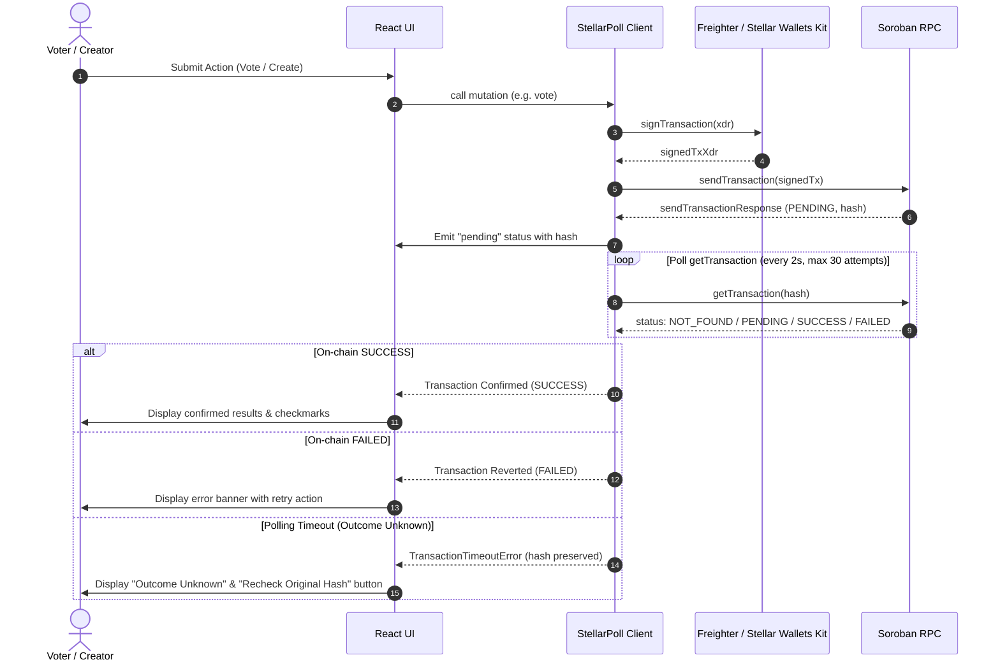

# StellarPoll Architecture & Engineering Specification

This document details the system design, smart contract lifecycle, storage model, authorization boundaries, and transaction confirmation mechanisms of StellarPoll.

---

## 1. High-Level Architecture

StellarPoll operates as a decentralized, non-custodial polling platform with no centralized backend database. All state resides on the Stellar blockchain via Soroban smart contracts.

```
┌────────────────────────────────────────────────────────┐
│                   React 19 Frontend                    │
│   (PollCreator, PollList, PollCard, ContractSetup)    │
└───────────────────────────┬────────────────────────────┘
                            │
┌───────────────────────────▼────────────────────────────┐
│                  StellarPoll Client SDK                │
│    (Read Queries, Tx Submissions, Confirmation Loop)   │
└──────────────┬───────────────────────────┬─────────────┘
               │ (Direct Queries)          │ (Sign Calls)
               │                           │
┌──────────────▼────────────┐  ┌───────────▼─────────────┐
│    Soroban RPC Server     │  │   Stellar Wallets Kit   │
│ (https://soroban-testnet) │  │  (Freighter / Albedo)   │
└──────────────┬────────────┘  └───────────┬─────────────┘
               │                           │
┌──────────────▼───────────────────────────▼─────────────┐
│          Soroban Smart Contract (LivePoll)             │
│   - Instance Storage: NEXT_ID, ADMIN                   │
│   - Persistent Storage: (POLL, id), (VOTED, id, voter) │
│   - Time Invariants: start_time, end_time              │
│   - Auth Invariants: creator auth, voter auth          │
└────────────────────────────────────────────────────────┘
```

---

## 2. Smart Contract Design

### 2.1 State Representation & Storage Model

Soroban differentiates between **instance storage** (shared contract metadata) and **persistent storage** (independent records).

1. **Instance Storage**:
   - `NEXT_ID_KEY` (`Symbol("NEXT_ID")`): A monotonically increasing `u32` counter tracking the total number of polls created.
   - `ADMIN_KEY` (`Symbol("ADMIN")`): The optional deployer/administrator address.
   - *TTL Management*: Refreshed on every operation (`threshold: 50,000 ledgers`, `bump: 100,000 ledgers`).

2. **Persistent Storage**:
   - `(&Symbol("POLL"), poll_id)`: Stores the full `Poll` struct.
   - `(&Symbol("VOTED"), poll_id, voter)`: Stores a boolean flag indicating that `voter` (`Address`) has cast a vote on `poll_id`.

```rust
pub struct Poll {
    pub id: u32,
    pub question: String,
    pub options: Vec<String>,
    pub votes: Vec<u32>,
    pub creator: Address,
    pub total_votes: u32,
    pub active: bool,
    pub start_time: u64,
    pub end_time: u64,
    pub allowlist: Vec<Address>,
}
```

### 2.2 Storage Lifetimes (Ledger-Sequence TTL vs. Timestamp Deadlines)
Soroban decouples **storage TTL** (measured strictly in ledger sequence numbers) from **poll deadlines** (`start_time` and `end_time`, measured in Unix timestamp seconds):
- Because Stellar ledger closing intervals vary with consensus, a timestamp deadline (`end_time`) cannot provide an absolute mathematical proof of how many ledgers will close before the deadline.
- On poll creation and on every vote, the contract extends the TTL of the contract instance, `(&Symbol("POLL"), poll_id)`, and `(&Symbol("VOTED"), poll_id, voter)` by the same ledger-sequence count (`max(100_000, estimated_ledgers + 10_000)`), clamped by `env.storage().max_ttl()` so it never exceeds the network's `max_entry_ttl` limit.
- **Persistent State Archival Semantics**: In Soroban (Protocol 20+), persistent entries (`POLL` and `VOTED`) that reach TTL = 0 are **archived**, never deleted as missing entries. An archived `VOTED` marker does **not** evaluate to `has() == false` or allow a duplicate vote. Instead, any transaction whose footprint touches an archived persistent entry fails host storage validation until an explicit `RestoreFootprintOp` restores the archived entry back into live state with its original `true` value intact.

---

## 3. Cryptographic Authorization & Invariants

| Action | Function | Authorization | Enforced Invariants |
|---|---|---|---|
| Initialize | `initialize(admin)` | `admin.require_auth()` | Fails if contract was already initialized. |
| Create Poll | `create_poll_advanced(...)` | `creator.require_auth()` | - Question: 3–280 chars<br>- Options: 2–10 options<br>- Option length: 1–100 chars<br>- `end_time > start_time` if set<br>- `end_time - start_time <= 30 days`<br>- `allowlist <= 50` addresses |
| Vote | `vote(voter, id, index)` | `voter.require_auth()` | - Poll must exist (`PollNotFound`)<br>- Poll must be open (`PollNotStarted` or `PollClosed`)<br>- Option index must be in bounds (`InvalidOptionIndex`)<br>- Voter must be in allowlist if allowlist is populated (`NotAllowedToVote`)<br>- Voter must not have already voted (`AlreadyVoted`) |
| Close Poll | `close_poll(caller, id)` | `caller.require_auth()` | - Caller must match `poll.creator` (`NotAuthorized`)<br>- Poll must be currently active (`PollAlreadyClosed`) |

### 3.1 Dynamic Lifecycle Invariant
Poll status is evaluated deterministically at ledger time:
$$\text{Status}(t) = \begin{cases} 
\text{Closed} & \text{if } \neg\text{active} \lor (t_{\text{end}} > 0 \land t > t_{\text{end}}) \\
\text{Scheduled} & \text{if } t_{\text{start}} > 0 \land t < t_{\text{start}} \\
\text{Open} & \text{otherwise}
\end{cases}$$

This removes any dependency on off-chain cron bots or keeper transactions to transition between Scheduled, Open, and Closed.

---

## 4. Transaction Confirmation Pipeline

Previous iterations made optimistic UI updates upon initial submission. StellarPoll enforces a **verified on-chain confirmation loop**:



### 4.1 Refresh-Safe Persistence & Timeout Handling
Before polling begins, the pending transaction is stored in browser `localStorage` scoped by `(network, contractId, walletAddress)`.
- If the user navigates away or refreshes the page, `App.tsx` detects the pending hash on mount and resumes polling.
- If polling times out without a terminal `SUCCESS` or `FAILED` response, the transaction is treated as an **unknown outcome** (`TransactionTimeoutError`), not a failure. The pending hash is preserved so the user can recheck the original transaction via `recheckTransactionStatus(rpcServer, hash)` before deciding whether to resubmit.

---

## 5. Pagination vs. N+1 RPC Elimination

Legacy implementations executed sequential loops:
$$\text{Requests} = 1 + 3N \quad (\text{for } N \text{ polls})$$
For 50 polls, this triggered 151 HTTP requests every 15 seconds.

StellarPoll introduces **contract-level reverse-chronological pagination**:
```rust
pub fn get_poll_page(env: Env, page: u32, page_size: u32) -> Vec<Poll>
```
1. Fetching a page requires **exactly 1 RPC simulation request**.
2. Voter eligibility on the page executes in a single batched `Promise.all` across the 5 items.
3. Network overhead is reduced by $>95\%$, preventing testnet rate limits.
